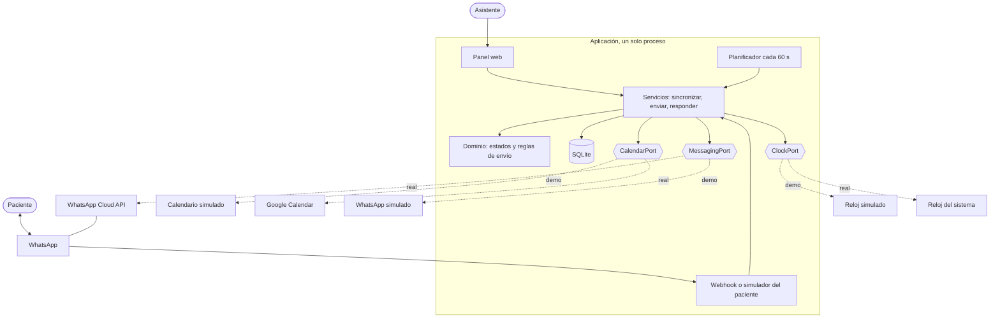
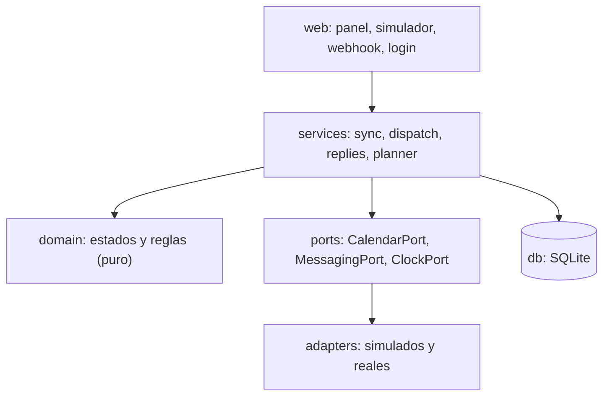
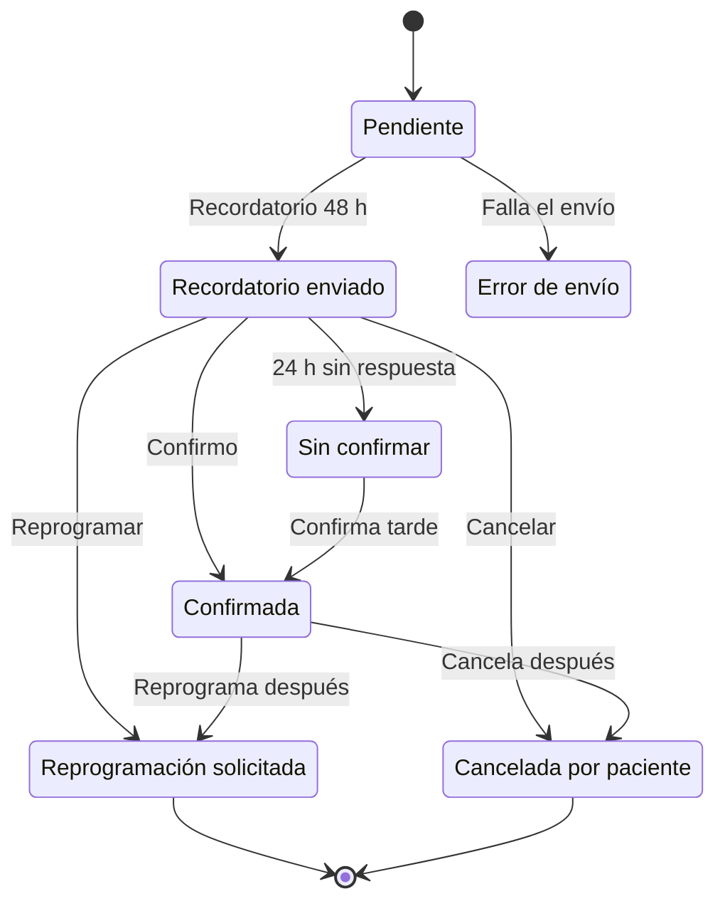

# Recordatorios y confirmación de citas para consultorio dental

Aplicación web ligera que reduce las inasistencias de un consultorio dental pequeño. Envía recordatorios por WhatsApp 48 h y 24 h antes de cada cita, permite al paciente **confirmar, reprogramar o cancelar con un toque**, y muestra a la asistente, en un panel pensado para celular, el estado de cada cita y cuáles requieren su atención. Se integra con Google Calendar, que sigue siendo la fuente de verdad de la agenda.

> **Estado del proyecto.** Funciona de punta a punta en **modo demo**, con un calendario y un WhatsApp simulados y pacientes ficticios. Los adaptadores reales de Google Calendar y WhatsApp Business están escritos y probados **solo con respuestas simuladas**; no se han verificado contra los servicios reales (ver [Limitaciones conocidas](#limitaciones-conocidas)).

**Contenido:** [Problema](#problema-y-objetivo) · [Funcionalidades](#funcionalidades) · [Arquitectura](#arquitectura) · [Ciclo de una cita](#ciclo-de-vida-de-una-cita) · [Inicio rápido](#inicio-rápido) · [Configuración](#configuración) · [Modo real](#usar-los-servicios-reales) · [Privacidad](#privacidad-y-cumplimiento) · [Pruebas](#pruebas-y-calidad) · [Metodología](#metodología-spec-driven-development) · [Prompts](#trabajar-con-el-agente) · [Limitaciones](#limitaciones-conocidas) · [Hoja de ruta](#hoja-de-ruta)

## Problema y objetivo

La Dra. Laura agenda en Google Calendar y ese flujo funciona bien, pero:

- Cerca del **30 % de los pacientes no llegan** y esos espacios se pierden.
- La asistente pasa buena parte de la mañana enviando recordatorios por WhatsApp uno por uno.
- Los tratamientos de varias sesiones se abandonan a la mitad (se aborda en una spec posterior).

| Meta de negocio | Cómo se mide |
|---|---|
| Inasistencias de ~30 % a menos del 10 % | Citas no asistidas sobre citas agendadas, en un periodo a definir con la doctora |
| Tiempo manual de recordatorios cercano a cero | Horas semanales de la asistente dedicadas a enviarlos |

Estas metas **no se comprueban con pruebas automáticas**: se miden con el consultorio funcionando. Lo que sí se verifica en la demo son los cinco criterios de aceptación de la spec.

## Funcionalidades

- Lectura de las citas de Google Calendar (solo lectura; la app no modifica el calendario).
- Recordatorios automáticos por WhatsApp a 48 h y 24 h, dentro de una ventana de envío de 8:00 a 20:00.
- Respuesta de un toque: **Confirmo**, **Reprogramar** o **Cancelar**; la última respuesta antes de la cita es la que cuenta.
- Panel de la asistente con **Requieren atención** accionable (reprogramaciones, cancelaciones, citas sin confirmar, errores de envío, citas sin teléfono y sin consentimiento) y **Agenda de hoy / próximas citas** en filas.
- **Edición de nombre y teléfono** desde la agenda simulada, para corregir una cita «Sin teléfono» sin borrarla y crearla de nuevo.
- **Lista de espera y recuperación de espacios liberados:** cuando se cancela o mueve una cita, la app detecta el espacio, propone candidatos y envía una oferta de un toque; la asistente mueve la cita en Google Calendar y confirma. (Spec 003, en modo demo.)
- Reintentos de envío sin duplicar mensajes, y ningún fallo silencioso.
- Respeto del consentimiento y de la baja del paciente.
- **Modo demo** ejecutable sin credenciales, con simulador del paciente y reloj adelantable.

**Fuera de alcance:** facturación, pagos, expediente clínico, historia clínica, odontograma e inventario.

## Arquitectura

La lógica de negocio no depende de WhatsApp ni de Google: cada servicio externo está detrás de una interfaz (puerto) con un adaptador simulado y uno real. El modo (`demo` o `real`) elige los adaptadores al arrancar.



Capas y dirección de dependencias (la lógica no depende de las integraciones):



### Decisiones principales

| Decisión | Motivo |
|---|---|
| Un solo proceso (Python + FastAPI) con planificador interno | Sin servicios que administrar; el reloj inyectable permite simular el tiempo en la demo |
| SQLite | Mantenimiento mínimo; para producción real conviene migrar a un servicio gestionado |
| Sondeo de Calendar cada 5 min con sincronización incremental | Más simple que las notificaciones push, que exigen URL pública y renovar canales |
| Panel en HTML renderizado en servidor | Una sola pantalla; sin cadena de compilación |
| Puertos y adaptadores | Pruebas sin servicios reales y demo sin credenciales |

El detalle completo, con las alternativas descartadas y las fuentes verificadas, está en [`plan.md`](specs/001-recordatorios-confirmacion/plan.md).

## Ciclo de vida de una cita



Una cita confirmada recibe igualmente el recordatorio de 24 h. Las citas sin teléfono válido o sin consentimiento no reciben mensajes y se muestran como «Sin teléfono» o «Sin consentimiento». Todos los estados y reglas están en [`spec.md`](specs/001-recordatorios-confirmacion/spec.md).

## Inicio rápido

Requisitos: Python 3.12 o superior. La demo no necesita ninguna credencial.

```bash
python -m venv .venv && source .venv/bin/activate    # en Windows: .venv\Scripts\activate
pip install -r requirements.txt
uvicorn app.main:app --reload
```

Abre `http://127.0.0.1:8000`. En la demo puedes:

1. Ver la agenda y las citas que requieren atención.
2. Abrir `/sim`, leer los mensajes enviados y **responder como paciente**.
3. **Adelantar la hora simulada** para ver los recordatorios de 48 h y 24 h sin esperar.
4. **Agregar o corregir el teléfono** desde «Requieren atención» o desde la Agenda.
5. Forzar un fallo de envío y restaurar los datos de ejemplo.
6. Abrir **Lista de espera**, cancelar una cita en la Agenda, ofrecer el espacio liberado, responder «Lo tomo» en el Simulador y confirmar la recuperación.

## Configuración

Copia `.env.example` a `.env` (nunca se sube al repositorio). Valores por defecto entre paréntesis.

| Variable | Descripción |
|---|---|
| `MODE` | `demo` (por defecto) o `real` |
| `DATABASE_PATH` | Archivo de la base de datos SQLite (`data/recordatorios.db`) |
| `CLINIC_TIMEZONE` | Zona horaria del consultorio (nombre IANA; por defecto `America/Bogota`) |
| `SEND_WINDOW_START` / `SEND_WINDOW_END` | Ventana de envío (8 / 20) |
| `SYNC_INTERVAL_MINUTES` | Frecuencia de lectura del calendario (5) |
| `MAX_SEND_ATTEMPTS` | Intentos de envío antes de marcar error (3) |
| `UNCONFIRMED_AFTER_HOURS` | Horas tras el recordatorio de 24 h para marcar «Sin confirmar» (3) |
| `PANEL_PASSWORD`, `SESSION_SECRET` | Acceso al panel en modo real |
| `GOOGLE_*`, `WHATSAPP_*` | Credenciales de los servicios reales |
| `WHATSAPP_APP_SECRET` | Secreto para verificar la firma del webhook de WhatsApp (`X-Hub-Signature-256`) |

## Usar los servicios reales

Se activa con `MODE=real`. Requiere una app de Google con permiso de **solo lectura de eventos** y una cuenta de WhatsApp Business con plantillas aprobadas por Meta (`reminder_48h`, `reminder_24h` y una plantilla de espacio disponible, con botones de respuesta rápida).

Precios, límites de envío, plazos de aprobación de plantillas y disponibilidad por país **no están verificados**: consúltalos en la documentación oficial de Meta y de Google antes de usarlo con pacientes reales. Las fuentes consultadas y lo pendiente están al final de `plan.md`.

## Despliegue de la demo (Render)

Para publicar la demo con URL pública (T18):

1. Sube el repositorio a GitHub.
2. Render → New → Web Service → conecta el repositorio.
3. Build command: `pip install -r requirements.txt`
4. Start command: `uvicorn app.main:app --host 0.0.0.0 --port $PORT`
5. Deja `MODE=demo` (por defecto, sin credenciales).

La demo se siembra sola al arrancar. El SQLite es efímero (se recrea al reiniciar) y el servicio se duerme tras ~15 min sin tráfico (cold start de 30–60 s): aceptable para una demostración.

## Privacidad y cumplimiento

- **Solo datos mínimos:** nombre, teléfono, tipo de tratamiento en términos generales, avance en sesiones y estado de consentimiento. Nunca diagnósticos, notas clínicas ni imágenes.
- **Mensajes neutros:** sin detalles clínicos en lo que recibe el paciente.
- **WhatsApp solo por la API oficial,** con plantillas aprobadas y consentimiento previo; la baja del paciente se respeta de inmediato.
- **Google Calendar en solo lectura.**
- **Logs sin datos personales,** con teléfonos enmascarados; secretos solo en variables de entorno.
- **Este repositorio solo contiene datos ficticios.**
- La normativa de protección de datos aplicable depende del país del consultorio, que aún no está definido. Debe revisarse antes de un uso real.

## Pruebas y calidad

```bash
pytest -q
```

- **117 pruebas** en total: criterios CA-1 a CA-9 de la Spec 001, pruebas de la lista de espera y recuperación de espacios, y pruebas por requisito.
- Reglas del dominio probadas con reloj controlado: 48 h, 24 h, citas agendadas con poca anticipación, ventana horaria y cambios de horario.
- **Ninguna prueba llama a WhatsApp ni a Google.**

## Estructura del repositorio

```
├── AGENTS.md                         # cómo trabaja el agente
├── README.md
├── LICENSE
├── .gitignore                        # secretos y datos locales (no se suben)
├── .env.example                      # variables de entorno de ejemplo (sin valores)
├── requirements.txt                  # dependencias (demo, desarrollo y modo real)
├── pyproject.toml                    # configuración de ruff
├── setup.cfg                         # longitud de línea (pycodestyle)
├── .omp/skills/brand-design/         # identidad visual y tono
│   └── SKILL.md
├── specs/
│   ├── constitution.md               # principios innegociables
│   ├── 001-recordatorios-confirmacion/
│   │   ├── spec.md                   # qué y por qué
│   │   ├── plan.md                   # cómo
│   │   └── tasks.md                  # qué toca ahora
│   ├── 002-lanzamiento-produccion/   # ICP y user persona
│   └── 003-recuperacion-espacios/    # lista de espera y espacios liberados
├── app/                              # código
│   ├── main.py                       # punto de entrada
│   ├── app_factory.py                # fábrica de la app y planificador de fondo
│   ├── config.py                     # variables de entorno
│   ├── demo_seed.py                  # datos ficticios de la demo
│   ├── texts_es.py                   # textos en español
│   ├── domain/                       # lógica pura: modelos, estados, reglas
│   ├── services/                     # sync, dispatch, replies, planner, waitlist
│   ├── ports/                        # interfaces: calendar, messaging, clock
│   ├── adapters/                     # fake/real: calendar, messaging, clocks
│   ├── db/                           # esquema y repositorio SQLite
│   └── web/                          # rutas, plantillas y estáticos
├── data/                             # base local (se crea al arrancar; no se sube)
└── tests/
```

## Metodología: Spec Driven Development

La especificación manda y el código es su consecuencia. Flujo: constitución → spec → plan → tareas → código → validación. Cada documento tiene un único propósito:

| Documento | Responde a |
|---|---|
| `AGENTS.md` | Cómo trabaja el agente en este repositorio |
| `specs/constitution.md` | Qué principios no se pueden violar |
| `spec.md` | Qué se construye y por qué, con 17 requisitos y 5 criterios de aceptación verificables |
| `plan.md` | Cómo se construye y por qué, con fuentes verificadas |
| `tasks.md` | Qué toca ahora, trazable a los requisitos |
| `SKILL.md` (brand-design) | Cómo se ve y suena la aplicación |

Si un resultado no cumple un criterio, se corrige la **spec** antes que el prompt o el código.

## Trabajar con el agente

Los prompts de cada etapa se pegan en la herramienta agéntica (por ejemplo, Oh My Pi / OMP). Las reglas permanentes ya están en `AGENTS.md`.

**1. Revisión de consistencia y redundancia (antes de implementar)**

```text
Lee AGENTS.md, specs/constitution.md, la carpeta specs/001-recordatorios-confirmacion/
(spec.md, plan.md, tasks.md) y .omp/skills/brand-design/SKILL.md.
No modifiques nada. Haz dos revisiones.

1. Trazabilidad
- Cada RF de spec.md tiene al menos una tarea en tasks.md.
- Cada tarea cita RF que existen; cada CA tiene una tarea que lo verifica.
- Los nombres de los estados son idénticos en spec, plan y skill.
- Las decisiones confirmadas (recordatorios a 48 h y 24 h, ventana de envío de
  8:00 a 20:00, el recordatorio de 24 h también para quien ya confirmó) aparecen
  igual en todos los documentos.
- Ningún documento contradice a la constitución.

2. Redundancia
Cada documento tiene un único propósito: constitución = principios; spec = qué y por
qué; plan = cómo; tasks = qué toca ahora; AGENTS.md = cómo trabaja el agente.
Detecta reglas, decisiones o pasos definidos en más de un documento. Una cita o
referencia a otro documento NO es duplicación; una definición repetida, sí.

Entrégame una tabla con: hallazgo, documentos afectados, documento que debería ser la
fuente única y acción propuesta (eliminar, reducir a una referencia o conservar por
ser una repetición deliberada, justificándolo). Espera mi decisión antes de editar.
```

**2. Implementación (una tarea cada vez; sustituye `{tarea}` por T1, T2…)**

```text
Implementa SOLO la tarea {tarea} de specs/001-recordatorios-confirmacion/tasks.md,
siguiendo plan.md y la constitución. Escribe primero los tests, luego el código.
Ejecuta pytest -q y muéstrame el resultado. Al terminar: marca la tarea en
tasks.md, indica qué RF cubre y PÁRATE. No empieces la siguiente tarea.
```

**3. Validación (al terminar la implementación)**

```text
Recorre specs/001-recordatorios-confirmacion/spec.md requisito por requisito
(RF-1 a RF-18) y criterio por criterio (CA-1 a CA-9). Para cada uno indica qué
test lo cubre y el resultado de ejecutarlo. Si alguno no está cubierto o falla,
dilo claramente y propón primero la corrección de la spec, no del código.
Después comprueba los criterios de finalización y dame un veredicto: ¿la spec
está cumplida?
```

## Limitaciones conocidas

- Los adaptadores reales de Google y WhatsApp no se han probado contra los servicios reales.
- Las plantillas de WhatsApp deben ser aprobadas por Meta antes de su uso, y la app de Google puede requerir verificación para producción.
- SQLite pierde los datos al reiniciar en hosts de disco efímero; en la demo se restauran los datos de ejemplo.
- La aplicación no escribe en Google Calendar: la asistente reprograma o elimina las citas allí.
- Un solo consultorio, un solo calendario y una sola zona horaria.
- Los valores iniciales (ventana de envío, plazo para «Sin confirmar», reintentos) están pendientes de validar con la doctora.

## Hoja de ruta

Cada punto sería una spec propia:

1. Seguimiento de tratamientos de varias sesiones y alerta de abandono.
2. Lista de espera y reasignación de espacios liberados.
3. Métricas de inasistencia y finalización de tratamientos.
4. Migración a una base de datos gestionada para producción.

## Licencia

MIT. Ver [`LICENSE`](LICENSE).
